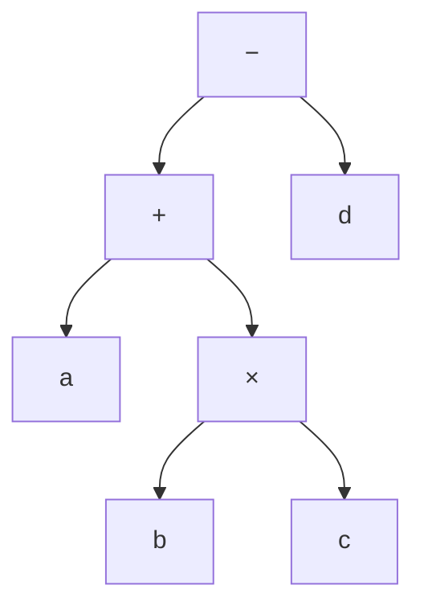

[Project overview](../README.md) · [Current CPU results](../native/RESULTS.md) · [Native witness-mask optimization](../native/WITNESS_MASKS.md)

# Two-Scan Binding-Power Parsing

*From lexer tokens to an exact abstract syntax tree*

A worked introduction, implementation guide, and correctness argument for a scan-based tree construction.

An expression such as `a + b * c - d` is a sequence of tokens, but its meaning depends on a tree. Multiplication groups `b` and `c`; addition groups `a` with that product; subtraction sits above the result and `d`.

The interesting question is how to discover all those connections in parallel, including when the resulting tree is a long chain.

The construction described here separates **discovering tree links** from **materializing nested AST tuples**. Two suffix scans recover information about a conceptual operator stack. Small local rules then assign every operator parent and operand attachment using stable integer references. The resulting arrays already represent the exact tree; the language wrapper later exports nested tuples.

For one already-normalized group with `n` operators and `C` distinct encoded right binding powers, the construction has:

\[
W(n,C)=O(Cn),\qquad M(n,C)=O(Cn),\qquad D(n,C)=O(\log(n+1)).
\]

Here `W` is total work, `M` is space in machine words, and `D` is parallel span: the longest chain of dependent steps. The state encoding is assumed to be supplied. For a fixed language table, `C` is constant, giving linear work and space and logarithmic span.

The accompanying Python is a sequential reference implementation of that parallel computation. Its complete source-to-tuple pipeline also includes grouping and export, which are outside this theorem. The article first explains the pipeline intuitively, then derives both scans and proves the structural result. Sections 22–25 describe the cleaned four-module package; Appendix D contains the complete source of every runtime file.

## Part I: Following an expression through the parser

### 1. What the input and output look like

The running program is:

```text
(a + b * c - d);
```

The parentheses deliberately create an expression group that we can examine separately from its surrounding statement.

The lexer returns:

```python
['(', 'a', '+', 'b', '*', 'c', '-', 'd', ')', ';']
```

The expression AST eventually represents:

```python
('-', ('+', 'a', ('*', 'b', 'c')), 'd')
```

The complete program adds a statement node and a block node:

```python
('block',
    ('expr',
        ('-',
            ('+', 'a', ('*', 'b', 'c')),
            'd')))
```

The leaves in this implementation are token strings. For example, the literal `12` remains `'12'`; numeric conversion belongs to a later stage.

The major transformations are:

| Stage | Input | Output | Responsible code |
|---|---|---|---|
| Tokenization | Source string | List of token strings | `lexer.tokenize` |
| Grouping | Token list | Group frames, classified items, and placeholder boxes | `frontend.build_groups` |
| Normalization | One group's items | `vals` and `ops`, with `len(vals) == len(ops) + 1` | `frontend.build_flat` |
| Structural discovery | Left/right binding-power arrays | Pop events, same-event neighbors, parents, children, root | `two_scan.discover`, called by `parser.plan_group` |
| Type checks and group export | Original inputs and structural plan | Nested tuples; top-level statement sequence flattened | `parser.build_ast` |
| Group validation | One group's result | Validated result stored in its box | `parser.parse_group` |
| Program assembly | Results stored in group boxes | Complete nested-tuple AST | `frontend.resolve` |

The two-scan contribution is in structural discovery. Understanding the surrounding stages makes its input contract precise.

### 2. Grouping: separating nested syntax

Parentheses and braces delimit groups. A group is a flat parsing problem whose operands may include references to nested groups.

For the example, the expression group contains:

```text
a + b * c - d
```

The outer statement group contains an expression placeholder followed by `;`.

A `Box` holds a group's declared category—expression or statement—and later receives its parsed value. An enclosing group can use that box as an opaque operand while constructing its own local links. Its structure does not require inspecting the nested group's internal nodes.

`build_groups` also performs language-specific decisions:

- It classifies `-` as prefix negation or binary subtraction from its left context.
- It packages `if (...)` and `while (...)` as prefix header operators carrying a condition box.
- It matches `else` with an unmatched `if` in the current grouping context and creates a separate group for the then-branch.
- It checks delimiters and rejects unsupported tokens.

These operations belong to the toy-language front end. The two scans receive the groups after these decisions have been made. The implementation's grouping pass is sequential.

### 3. Normalization: making every group alternate

The structural algorithm expects:

\[
v_0\ o_0\ v_1\ o_1\ \cdots\ o_{n-1}\ v_n.
\]

There are `n` operators and `n + 1` operand slots. `build_flat` stores them in separate arrays:

```python
vals = ['a', 'b', 'c', 'd']
ops  = [plus, multiply, minus]
```

The corresponding indices are:

| Operand index | Value | Operator index immediately to its right |
|---|---|---|
| 0 | `a` | 0: `+` |
| 1 | `b` | 1: `*` |
| 2 | `c` | 2: `-` |
| 3 | `d` | None |

Unary operators use an empty placeholder, `EPS`, in their unused slot:

```text
-a  becomes  EPS neg a
a;  becomes  a ; EPS
```

The structural algorithm can therefore treat these as binary nodes. When the semantic AST is exported, negation uses only its right child and the statement terminator uses only its left child.

Between adjacent statement-shaped items, normalization introduces an invisible `seq` operator. The structural representation initially keeps `seq` binary. A later pass flattens a top-level sequence into the list of statements expected by a block.

Normalization also rejects invalid local arrangements, such as an infix operator where an expression operand is required. Later type checks distinguish expressions from statements.

### 4. Binding powers: a numerical rule for structure

Each operator has a left binding power `lbp` and a right binding power `rbp`. Write these as `L_i` and `R_i` for operator `i`.

When operator `j` arrives, a conceptual stack parser reduces its current top operator `i` while:

\[
R_i > L_j.
\]

The strict inequality is part of the definition. The numeric table encodes both precedence and associativity.

The reference language uses:

| Operator | Fixity | `lbp` | `rbp` | Role |
|---|---|---:|---:|---|
| `seq` | Infix | 1 | 2 | Sequence of statements |
| `if`, `ifelse`, `while` header | Prefix | `INF` | 5 | Attach a statement body |
| `;` | Postfix | 10 | `INF` | Turn an expression into a statement |
| `=` | Infix | 21 | 20 | Right-associative assignment syntax |
| `+`, `-` | Infix | 30 | 31 | Left-associative addition/subtraction |
| `*`, `/` | Infix | 40 | 41 | Left-associative multiplication/division |
| `neg` | Prefix | `INF` | 45 | Unary negation |
| `^` | Infix | 51 | 50 | Right-associative exponentiation |

In the code, `INF` is the reserved value `10**9`. Prefix operators have `lbp == INF`; postfix operators have `rbp == INF`; non-prefix left binding powers are below `INF`, and no binding power exceeds it. This makes the fixity conventions compatible with the same numerical comparison.

For subtraction, the next `-` causes the previous one to reduce because `31 > 30`. Thus:

```text
a - b - c  groups as  (a - b) - c
```

For exponentiation, `50 > 51` is false. The first `^` remains pending while the second is pushed:

```text
a ^ b ^ c  groups as  a ^ (b ^ c)
```

Prefix negation has a weaker right binding power than exponentiation's left binding power, so `-a ^ b` groups as `-(a ^ b)` in this language.

### 5. The information supplied by the first scan

Define:

```text
pop[i] = the incoming operator that removes operator i
```

Use `n` for the end-of-group flush. A pop event identifies when a reduction happens; it does not identify the source position of the reduced operator.

For `a + b * c - d`, the operators are indexed `0`, `1`, and `2`.

| Operator `i` | Symbol | `pop[i]` | Explanation |
|---:|---|---:|---|
| 0 | `+` | 2 | Incoming `-` removes it |
| 1 | `*` | 2 | Incoming `-` removes it first |
| 2 | `-` | 3 | End of group removes it |

Therefore:

```python
pop = [2, 2, 3]
```

Knowing only these events does not yet tell us every parent. Operators sharing an event reduce from right to left, so their relative order must also be recovered.

### 6. The information supplied by the second scan

Define:

```text
next_same[i] = the next source index with the same pop event
```

If no such operator exists, store `-1`.

For the example:

```python
next_same = [1, -1, -1]
```

The `+` and `*` share pop event 2. The stack removes `*` first, then uses that subtree as the right operand of `+`. Consequently, `*` becomes a right child of `+`.

The second scan discovers these neighbors without explicitly collecting and sorting operators into pop-event buckets.

### 7. Turning those arrays into parents and children

Initialize each parent to its pop event, translating the end-of-group event into no parent:

```python
parent = [2, 2, -1]
```

Then apply:

```python
if next_same[i] != -1:
    parent[next_same[i]] = i
```

This gives:

```python
parent = [2, 0, -1]
```

In source order, an operator child before its parent is a left child; a child after its parent is a right child. The operand leaves fill the remaining slots according to the reduction order of their two adjacent operators.

The final operator relationships are:

| Operator | Parent | Left child | Right child |
|---|---|---|---|
| 0: `+` | 2: `-` | `a` | 1: `*` |
| 1: `*` | 0: `+` | `b` | `c` |
| 2: `-` | None | 0: `+` | `d` |



The code encodes an operator child as its nonnegative index and operand `k` as `-(k + 1)`:

```python
left  = [-1, -2,  0]
right = [ 1, -3, -4]
root  = 2
```

Here `left[0] == -1` means operand 0, not a missing child. The interpretation depends on which array is being read: parent arrays use `-1` for no parent, whereas child arrays use negative numbers to identify operands.

### 8. Representing nodes with stable indices

Operator index `i` is already a stable node reference. The operator descriptor
is `ops[i]`; its children are `plan.left[i]` and `plan.right[i]`. No separate
`Ref` class or copied arena is needed.

For the running expression, these illustrative triples show the representation:

```python
# (operator name, left reference, right reference)
nodes = [
    ('+', -1, 1),
    ('*', -2, -3),
    ('-', 0, -4),
]
root = 2
```

The implementation keeps these fields in arrays instead of allocating this
additional list. Node 0 can store child reference 1 before node 1 has been
exported as a tuple. A reference identifies a slot; it does not require a
completed child value. Each parent/child destination has its own writer in
the appropriate attachment phase.

A long, skewed AST can be represented this way in parallel. Its height still
matters for operations that actually depend on completed child results, such
as arbitrary semantic evaluation. Constructing its links has a different
dependency structure. The Python wrapper's tuple export is sequential and
uses an iterative traversal so that deep trees do not require Python recursion.

The rest of the article explains how the scans obtain the two arrays and why
the attachment rules reproduce the specified stack parser.

## Part II: Deriving the scans

### 9. The exact problem being solved

The normalized-group contract is:

1. `vals` contains `n + 1` operand objects.
2. `ops` contains `n` operators, each with numerical `L_i` and `R_i`.
3. Prefix/postfix operators follow the sentinel conventions above.
4. Nested groups have already been represented by opaque operands.
5. The target reduction rule is to pop the top operator `i` before pushing incoming operator `j` exactly while `R_i > L_j`; all remaining operators pop at EOF.

This last rule defines the reference structure independently of the implementation. It accommodates independently chosen left and right binding powers; the proof does not require a single globally ordered precedence class for each operator.

`parser.plan_group(vals, ops, states=None)` checks the operand count and fixity conventions, then extracts the powers for `two_scan.discover(lbp, rbp, states=None)`. The numerical core receives equal-length power arrays and treats the `n + 1` operand slots as implicit; it needs no token strings, `Box` objects, or operator names.

The output is a binary structural plan. For unary operators, one structural side is ignored during semantic export. Local type requirements determine whether that structure is accepted by the toy-language constructor.

When `n == 0`, there is one operand and no operator node. `discover` returns empty link arrays and `root=None`; `build_ast` returns that operand directly. The following derivation assumes `n >= 1`.

### 10. The running-minimum invariant

Fix operator `i` immediately after it has been pushed. Imagine following the stack parser until `i` is removed.

Just before a later operator `j` arrives, suppose `i` is still present. The key invariant is:

> The minimum right binding power among all operators read from `i` through `j-1` equals the minimum right binding power among the current stack entries from `i` upward.

The first set contains operators that may already have been removed. The invariant says those removals do not change the relevant minimum while `i` survives.

**Proof.** Initially, both sets contain only `i`. Suppose an incoming token `j` removes some entries above `i` but leaves `i` in place. Every removed entry has right binding power greater than `L_j`. The surviving top entry that stops the loop has right binding power at most `L_j`. Thus every removed value is greater than a value that remains in this stack suffix. Removing those entries cannot lower or raise its minimum. Pushing `j` then takes the minimum with `R_j` in both descriptions. Induction proves the invariant. ∎

The pop loop reaches and removes `i` exactly when every right binding power in that suffix exceeds `L_j`. By the invariant, this is equivalent to:

\[
\min_{i\le k<j}R_k > L_j.
\]

Consequently, `pop[i]` is the first such `j`, or `n` when no such position exists:

\[
\operatorname{pop}(i)=
\min\left(\{j>i:\min_{i\le k<j}R_k>L_j\}\cup\{n\}\right).
\]

Operationally, start at `s = R_i`. For each later token `j`, stop if `s > L_j`; otherwise replace `s` with `min(s, R_j)`.

The state never becomes an arbitrary number. A minimum of right binding powers is itself one of those right binding powers. That observation makes small transition tables possible.

#### Why an intervening operator matters

Replacing the interval minimum with the original `R_i` would give the simpler query:

\[
U_{\mathrm{raw}}(i)=
\min\left(\{j>i:R_i>L_j\}\cup\{n\}\right).
\]

That query can fail under independently chosen binding powers. Consider `a A b B c C d`:

| Operator index | Name | `L` | `R` |
|---:|---|---:|---:|
| 0 | `A` | 0 | 10 |
| 1 | `B` | 11 | 1 |
| 2 | `C` | 5 | 0 |

When `B` arrives, `10 > 11` is false, so it is pushed above `A`. When `C` arrives, `1 > 5` is false: `B` remains on the stack and prevents the pop loop from reaching `A`. All three operators survive until EOF.

```python
raw_nearest = [2, 3, 3]
pop         = [3, 3, 3]
```

Although `R_A > L_C`, the relevant running minimum at `C` is `min(10, 1) == 1`. The interval-minimum equation therefore predicts the correct result. The resulting binary structure is `A(a, B(b, C(c, d)))`.

A mixed-fixity example is `p q x !`, where the prefixes have right powers 10 and 4 and the postfix has left power 6. With the usual unary sentinel powers, the inner prefix similarly blocks the outer one. Appendix C gives executable checks for both examples.

The relevant comparisons contain no ties. The distinction is the intervening operator's binding power. Section 26 compares this with the historical nearest-position formula for a conventional priority table. These examples use the broader numerical contract of this article; they do not contradict that historical result within its stated setting. [1]

### 11. The state set and absorbing outputs

Let:

\[
Q=\{q_0<q_1<\cdots<q_{C-1}\}
\]

contain every right binding power used by the group. A fixed language can supply a predefined superset instead. Let `r[i]` be the index of `R_i` in `Q`. In the implementation these are named `states` and `rank`.

For the running expression:

```python
Q = [31, 41]
C = 2
r = [0, 1, 0]
```

There are two kinds of values in a summary:

- **Live states:** an index into `Q`, meaning continue scanning with that running minimum.
- **Terminal outputs:** an operator position that has already been found, meaning preserve this answer.

The tables have `C` input entries. Terminal outputs are absorbing and need no explicit table entries of their own. This is a bounded set of live states with position-valued outputs; it is not a claim that every possible token position is one of a constant number of automaton states.

In the Python encoding, live states are integers below `C`, and terminal position `j` is encoded as `C + j`.

### 12. First-scan transition tables

For each token `j`, define:

\[
F_j(s)=
\begin{cases}
\operatorname{hit}(j),&s>L_j,\\
\min(s,R_j),&s\le L_j.
\end{cases}
\]

This formula uses actual binding-power values for readability. The stored implementation uses their indices.

The first-scan tables for the example are:

| Token table | Input state 31 | Input state 41 |
|---|---|---|
| `F_0`, token `+` | `hit(0)` | `hit(0)` |
| `F_1`, token `*` | 31 | `hit(1)` |
| `F_2`, token `-` | `hit(2)` | `hit(2)` |

An isolated table answers a hypothetical question for every possible starting minimum. Some entries will never be queried directly by an actual operator; retaining them lets a whole substring be summarized independently of its preceding context.

Define `A ⊙ B` to mean “apply `A`, then `B`”:

```python
def compose(first, second):
    C = len(first)
    return tuple(second[code] if code < C else code for code in first)
```

If `first` has already produced a terminal, preserve it. Otherwise, feed its live state into `second`.

**Associativity.** Extend every table to act as the identity on terminal outputs. Then `A ⊙ B` is ordinary composition of these extended functions in execution order. Function composition is associative, so `(A ⊙ B) ⊙ D == A ⊙ (B ⊙ D)`. The identity table maps every live state to itself. ∎

Associativity permits a balanced scan. It does not imply commutativity: exchanging two tokens can change the answer.

### 13. Why an exclusive suffix scan gives all pop events

For each operator `i`, compute:

\[
A_i=F_{i+1}\mathbin{\odot}F_{i+2}\mathbin{\odot}\cdots\mathbin{\odot}F_{n-1}.
\]

This is an **exclusive suffix**: it includes the operators after `i` and excludes `i` itself. The empty suffix is the identity.

The code calls these tables `after`. Query `after[i]` at `R_i`:

- A terminal `hit(j)` gives `pop[i] = j`.
- A remaining live state means no later token popped `i`, so `pop[i] = n`.

For the running expression:

| `i` | Suffix summary | Query | Result |
|---:|---|---|---|
| 0 | `F_1 ⊙ F_2` | Start at 31 | `hit(2)` |
| 1 | `F_2` | Start at 41 | `hit(2)` |
| 2 | Identity | Start at 31 | Live state, interpreted as EOF 3 |

The running-minimum invariant establishes that these are exactly the stack parser's pop events.

### 14. How the suffix scan itself works

Pad the input to a power-of-two length `S` using identity tables. For `n >= 1`, `n <= S < 2n`.

The scan has two sweeps over a balanced binary tree:

1. **Upsweep.** Each internal node stores the composition of its left interval followed by its right interval.
2. **Downsweep.** Each node receives a carry representing everything after its interval. Its right child inherits that carry. Its left child receives the composition of the right sibling's summary followed by the carry.

At a leaf, the carry therefore summarizes exactly the tokens to that leaf's right.

The cleaned implementation reuses the summary tree as the carry buffer. After the upsweep, set `tree[1]` to the identity and process downsweep levels from the root. At each node:

```python
carry = tree[node]
tree[2 * node] = compose(tree[2 * node + 1], carry)
tree[2 * node + 1] = carry
```

The left assignment reads the right sibling's interval summary before that summary is replaced by its carry. Tables are immutable tuples, so sharing a carry between destinations does not mutate another node's table. This preserves the same ordered Blelloch schedule while removing a second tree-sized buffer.

At each level, different nodes are independent. Within a table composition, each output cell is also independent. One cell performs one indexed lookup or preserves one terminal value.

Each sweep has `log2(S)` levels and uses `S - 1` table compositions. This is the standard work-efficient scan pattern applied to noncommutative transition-table composition. [3, 4]

### 15. Deriving the second scan

The first scan gives every `pop[i]`. We still need the next operator to the right sharing each event.

Define `H_j(s)` as the first-hit position obtained by entering suffix `j..n-1` with state `s`; use `n` for no hit. Its empty-suffix base case is `H_n(s) = n`. The already-computed `after[j]` supplies `H_{j+1}` for any live state.

**Indexing detail:** `after[j]` already excludes position `j`. The witness table at `j` therefore queries `after[j][state]`, as the source comment emphasizes. Using `after[j+1]` would skip one extra token.

Now define:

\[
W_j(s)=\min\{h\ge j:\operatorname{pop}(h)=H_j(s)\},
\]

with a separate `NONE` result when the set is empty. Thus `W_j(s)` asks for the first token in this suffix whose pop event matches the hypothetical state's eventual hit. The empty-suffix base case is `W_n(s) = NONE`, since there is no token at or after position `n`.

There are three cases.

**Case 1: `s > L_j`.** The state hits token `j` immediately, so `H_j(s) = j`. But no operator at position `h >= j` can pop at `j`; an operator is pushed before any later token can pop it. Therefore `W_j(s) = NONE`.

**Case 2: `s <= L_j`, and operator `j` is a witness.** Set `x = min(s, R_j)`. The hypothetical state continues, so `H_j(s) = H_{j+1}(x)`. If `pop[j]` equals that event, `j` is the earliest possible witness, and `W_j(s) = j`.

**Case 3: no witness at `j`.** The target event is still `H_{j+1}(x)`. Search the remaining suffix with state `x`, giving `W_j(s) = W_{j+1}(x)`.

These cases define another token table:

\[
G_j(s)=
\begin{cases}
\operatorname{NONE},&s>L_j,\\
\operatorname{witness}(j),&s\le L_j\text{ and }\operatorname{pop}(j)=H_{j+1}(x),\\
x,&\text{otherwise},
\end{cases}
\qquad x=\min(s,R_j).
\]

All the `G_j` tables can be built independently after the first scan. They use the same composition routine: live states continue, and terminal outputs—including `NONE`—are absorbing.

An exclusive suffix scan over `G` yields a table `B_i` for each position. Querying `B_i(R_i)` gives:

\[
W_{i+1}(R_i)=\operatorname{next\_same}(i).
\]

Why? The eventual hit of state `R_i` through suffix `i+1` is exactly `pop[i]`, as established by the first scan.

For the example:

| Token table | Input state 31 | Input state 41 |
|---|---|---|
| `G_0`, token `+` | `NONE` | `NONE` |
| `G_1`, token `*` | `witness(1)` | `NONE` |
| `G_2`, token `-` | `NONE` | `NONE` |

Entering `G_1` with 31 continues through `*`, and both that state and `*` itself eventually hit `-` at position 2. Thus token 1 is the witness for operator 0.

The empty suffix returns a live state rather than a witness. The query interprets that as no match. The actual implementation encodes witness `j` as `C+j` and `NONE` as `C+n`.

## Part III: Proving the tree is exact

### 16. The pop-bucket lemma

For an incoming token `j`, consider all operators with pop event `j`. Write their source indices as:

\[
i_0<i_1<\cdots<i_t.
\]

They occur in that increasing order on the stack, and the stack removes them in decreasing order.

When `i_t` reduces, its result becomes the right operand used by `i_{t-1}`. Continuing down the bucket gives:

\[
\operatorname{parent}(i_h)=i_{h-1}\quad\text{for }h>0.
\]

The earliest operator `i_0` is removed last. Its completed subtree becomes the left operand carried into incoming token `j`. Thus:

\[
\operatorname{parent}(i_0)=j\quad\text{when }j<n.
\]

For EOF, the earliest operator in the EOF bucket is the final operator root and has no parent.

This proves the parent algorithm:

```python
parent = [p if p < n else -1 for p in pop]

for i, j in enumerate(next_same):
    if j >= 0:
        parent[j] = i
```

The initialization and overwrite steps are separate phases. Within the overwrite phase, every destination has at most one writer: an operator has at most one immediately preceding member in its pop bucket.

### 17. The operand-attachment lemma

Operand `v_k`, for `0 < k < n`, lies between operators `k-1` and `k`. It becomes a direct child of whichever adjacent operator reduces first. Until then, it occupies their shared operand boundary.

Pop events order reductions by increasing event position. At the same event, operators reduce in decreasing source index. Therefore:

\[
v_k\text{ attaches to }
\begin{cases}
\text{the right of }k-1,&\operatorname{pop}(k-1)<\operatorname{pop}(k),\\
\text{the left of }k,&\operatorname{pop}(k-1)\ge\operatorname{pop}(k).
\end{cases}
\]

In particular, equal events go to operator `k`, which is removed first.

The two boundary operands have only one adjacent operator: `v_0` is the left child of operator 0, and `v_n` is the right child of operator `n-1`.

Operator nodes use source order to select their child slot:

```python
if child_operator < parent_operator:
    left[parent_operator] = child_operator
else:
    right[parent_operator] = child_operator
```

The parent lemma and operand lemma recover exactly the child edges of the binary stack-reduction tree. Consequently, each child slot receives exactly one child, and there is exactly one operator root for `n >= 1`.

### 18. Structural correctness theorem

**Theorem.** For any normalized group satisfying the numerical input contract, `discover` produces the same operator root and binary child arrays as the stack parser defined in Section 9.

**Proof.** The running-minimum invariant identifies each stack pop event. Associative suffix composition evaluates exactly that first-hit process, so the first scan returns all true pop events. The witness recurrence identifies the earliest later token sharing each event, so the second scan returns all true `next_same` links. The pop-bucket lemma then gives the exact operator parents. Source order determines the side of each operator child, and the operand-attachment lemma gives every original operand edge. These are all edges of the reference tree. ∎

This theorem is about the tree defined by the stated operational semantics, even for numerical binding-power arrangements that are unusual in conventional languages. It does not assert a theorem about every operator-precedence grammar, arbitrary Pratt-parser callbacks, or every feature a production language might support.

### 19. Typed node construction and semantic export

The constructor assigns a fixed output category to each supported operator:

- Arithmetic and assignment operators produce expressions.
- `;`, headers, and `seq` produce statements.

It also knows the categories required by each used child slot. For example, `+` requires two expressions, `neg` requires one right expression, and `seq` requires two statements.

An operator child's nominal output category follows from its operator descriptor. The constructor can validate a parent without reading a completed child tuple. Invalid child nodes are also checked at their own slots, and a parallel error reduction can reject the group if any check fails.

**Corollary.** For this fixed, local type-and-shape model, the indexed structural representation and independent local type checks, followed by an any-error reduction, preserve the stack constructor's accepted tree or rejection result.

The corollary does not promise identical error messages or the same first reported error. It also depends on output categories being known locally. A richer system in which a node's type requires analyzing its children would need a separate analysis.

`parser.build_ast` first checks nominal child categories. Its optional `write_order` argument changes only the order of those independent checks; it does not change the structural plan or the tuple-export order.

Tuple export then uses an indexed `built` list and explicit postorder markers. Unary export ignores the unused `EPS` side. Header export inserts the condition and then-branch references stored in the operator descriptor. A final pass inside `build_ast` changes the group's top binary statement sequence into its n-ary representation. `parser.parse_group` validates the group result, and `frontend.resolve` unwraps boxes to assemble the public tuple AST.

Those surrounding transformations explain the full program output. Their implementation is separate from the structural theorem; this article does not provide a formal completeness proof of the entire toy-language front end.

### 20. A Cartesian-tree interpretation

There is another useful description of the operator-only tree. Assign position `i` the unique lexicographic key:

\[
K_i=(-\operatorname{pop}(i),i).
\]

The resulting operator tree is the **min-Cartesian tree** of these keys in source order.

To see this, the inorder traversal of the operator skeleton follows source order. A parent reduces after its child. For an edge between different pop events, the parent therefore has a larger pop event and a smaller first key component. For a same-event edge, the parent has the smaller source index. Every parent key is strictly smaller than its child's key. Inorder order plus unique heap priorities characterizes the Cartesian tree.

For the example:

```python
pop  = [2, 2, 3]
keys = [(-2, 0), (-2, 1), (-3, 2)]
```

The minimum is operator 2, so `-` is the root. Of the operators on its left, operator 0 has the smaller key, so `+` is above `*`.

This interpretation connects the construction to established parallel tree algorithms. [5] It also clarifies the role of the second scan: it is a specialized way to recover the necessary tree relationships after the first scan has supplied the pop events. The implementation does not call a generic Cartesian-tree routine.

## Part IV: Cost, implementation, and evidence

### 21. Work, span, and memory

Assume a shared-memory, CREW-style model: concurrent reads are allowed, distinct destinations have distinct writers, and indices and binding powers fit in machine words. Indexed access, comparisons, and minimum take constant time. Table cells can run independently, and the ordered state encoding is supplied.

Let `S` be the padded scan size. Each scan performs `S-1` upsweep compositions and `S-1` downsweep compositions. Two scans perform:

\[
4(S-1)
\]

compositions. Each processes `C` table entries, so the scan composition work is:

\[
4C(S-1)<8Cn.
\]

Constructing both families of token tables takes another `O(Cn)` work. Pop queries, witness queries, parent/child array assignments, and local type checks require `O(n)` additional work. Root selection and error aggregation can use work-efficient reductions.

The two scans have a constant number of logarithmic-depth sweeps. The remaining stages have constant depth apart from reductions. Therefore:

\[
W=O(Cn),\qquad D=O(\log(n+1)),\qquad M=O(Cn).
\]

On `p` processors, standard work-span scheduling gives:

\[
T_p=O\left(\frac{Cn}{p}+\log(n+1)\right).
\]

The practical meaning is:

| Setting | Consequence |
|---|---|
| Fixed language table | `C` is constant, so work and space are linear |
| Fixed finite processor count | The `n/p` term remains; wall-clock time does not become logarithmic for arbitrarily large inputs |
| Unbounded, input-dependent binding powers | `C` may be `Theta(n)`, making these table bounds quadratic |
| Table cells processed serially within each composition | A composition's span becomes `O(C)`; with fixed `C`, logarithmic asymptotics still hold |
| Multiple already-formed groups | Core work adds across groups; the group schedule must be specified separately |

The supplied language has at most eight distinct right-binding-power states, including `INF`. The Python reference discovers the used states with a set and sort; a fixed-language implementation can supply the encoding directly. No uniform linear-time sorting claim is needed or made.

Memory is measured in words. Terminal outputs contain source indices, so representing them requires enough bits for positions up to `n`.

### 22. What actually runs in the Python package

The reference has four runtime modules:

| Module | Responsibility |
|---|---|
| `lexer.py` | Token pattern, keyword rules, and operand recognition |
| `frontend.py` | Operator definitions, grouping, normalization, and box resolution |
| `two_scan.py` | Both suffix scans and all structural link rules |
| `parser.py` | Public entry point, independent type checks, and AST export |

All four execute ordinary Python loops. The core preserves the phase structure
of the parallel computation; it does not launch parallel workers. Its
sequential discovery work is `O(Cn)` after encoding, while its loop runtime
does not realize the logarithmic span.

The public entry point is:

```python
from parser import parse

tree = parse('(a + b * c - d);')
```

For one nonempty group, `parse_group` normalizes its items and makes this handoff:

```python
vals, ops = F.build_flat(group.items)
plan = plan_group(vals, ops)
result = build_ast(vals, ops, plan)
```

Here `F` is the `frontend` import in `parser.py`. `plan_group` validates the
normalization/fixity contract and calls the numerical core using only powers.
`build_ast` checks types and exports the planned tree; `parse_group` then
validates the result and stores it in the group's box. `parse_tokens` processes
the groups and calls `resolve` after their boxes have been filled.

Function responsibilities are:

| Function | Inputs | Outputs |
|---|---|---|
| `lexer.tokenize(source)` | Source string | Token strings |
| `frontend.build_groups(tokens)` | Token strings | Ordered group frames linked by boxes |
| `frontend.build_flat(items)` | One group's items | `vals`, `ops` |
| `two_scan.compose(first, second)` | Two equal-width tables | Their ordered composite; width is inferred |
| `two_scan.suffix_after(tables)` | Token tables | Exclusive suffix table at every index |
| `two_scan.discover(lbp, rbp, states=None)` | Equal-length power arrays and optional sorted encoding | `Plan(pop, next_same, parent, left, right, root)` |
| `parser.plan_group(vals, ops, states=None)` | Normalized group and optional encoding | Validated structural plan |
| `parser.build_ast(vals, ops, plan, write_order=None)` | Original inputs and plan | Typed tuple AST, with its top sequence flattened |
| `parser.parse_tokens(tokens, stats=None)` | Token strings | Resolved whole-program tuple AST |
| `parser.parse(source, stats=None)` | Source string | The same AST after tokenization |

The front-end records use small dataclasses. `eq=False` preserves identity-based
references between groups, and mutable frame lists have per-instance factories.
The old plateau-only `Op.cls` metadata is absent from this runtime. The numerical
core needs only its standard-library `dataclass` import and can be used alone.

This package has no runtime dependency on the earlier peak reducer, ranked
merger, chunk summaries, or copied arena records. Frozen original files remain
under `tests/baseline/` for comparison. Appendix D gives the complete cleaned
source, including the actual first-hit and witness transitions.

Tokenization, grouping, normalization as currently executed, tuple export,
sequence flattening, and final box resolution retain their separate costs.
The theorem covers structural discovery and the independent local checks;
the complete source-to-tuple pipeline is sequential in this reference.

### 23. Reading the statistics correctly

The command-line entry point prints the AST as Python tuples. Programmatic
callers can request the two small accounting fields:

```python
from parser import parse

stats = {}
tree = parse('x = a + b * c;', stats)
assert stats == {'work': 4, 'groups': 1}
```

| Field | What it measures |
|---|---|
| `work` | Normalized operators processed across all groups, including inserted `seq` operators |
| `groups` | Formed groups, including empty statement groups |

`work` is an operator count, not a complete work counter for the algorithm.
It excludes transition-table construction, table compositions, array handling,
lexing, grouping, and tuple export. Neither field measures elapsed time or
parallel span.

The old cost-record interface, contractor hook, and `--stats-only` option belong
to the frozen historical implementation. They are not part of the cleaned
runtime API. The bound in Section 21 comes from the stated computation model,
not from these two accounting fields.

### 24. Verification against independent descriptions

The companion `tests/verify.py` was run against the cleaned four-module implementation reproduced in Appendix D using Python 3.12.14. It checked:

| Test family | Cases | Checked properties |
|---|---:|---|
| Arbitrary transition tables | 2,000 sequences | Noncommutative suffix scan matches direct composition |
| Exhaustive short normalized groups | 9,175 | Pop events, same-event neighbors, binary links, typed trees/rejection, three type-check orders |
| Randomized binding powers and mixed fixities | 9,000 groups | Independent left/right powers, ties, and supported prefix/infix/postfix normalization |
| Generated whole programs | 20,000 | Exact tuple-tree agreement or joint rejection against the original and recursive descent |
| Front-end stages on those programs | 20,000 | Group order, box references, operator descriptors, normalization, and front-end rejection messages |
| Supplied state encodings | 1,070 | Plans agree with the default encoding, including unused states |
| Source-text entry point | 690 generated sources plus lexical edge cases | Tokenization and full parse results agree |
| Malformed API metadata | 9 | Matching outcomes or exception classes |
| Alternating negation/exponentiation chains | Four lengths, up to 16,384 repetitions | Expected exact AST on long skewed structures |

The 18,175 normalized-group cases comprise the exhaustive and randomized families above. The whole-program run accepted 7,951 inputs and rejected 12,049, with agreement in both cases. The long-chain maximum contained 32,770 normalized operators across its groups. All checks passed. The ascending, reversed, and shuffled orders vary independent type checks; tuple export itself remains sequential. The test adapter copies equivalent input descriptors between the old and new data models while preserving opaque-leaf identities for exact AST comparisons.

The verifier compares pop times with an ordinary stack simulation and child arrays with a separately constructed binary stack tree. It checks `next_same` against a right-to-left dictionary of the next position for each pop event. These simple sequential descriptions serve as differential oracles; they are not steps in the scan algorithm.

An additional check on the cleaned core used 10,000 randomized operator streams with independent left/right binding powers to compare the parent arrays with the Cartesian-tree construction from Section 20. That is supporting experimental evidence for the mathematical interpretation, not a full-language verification claim.

Separate focused checks, also rerun on the cleaned core, compared the running-minimum construction with the raw nearest-position query from Section 10:

| Comparison family | Cases | Result |
|---|---:|---|
| Conventional `+`, `*`, `^` table, operator-stream lengths 0–7 | 3,280 | Raw query, interval minimum, scan, and stack agree |
| All infix streams of lengths 0–4 with each left and right power in `{0,1,2}` | 7,381 | Interval minimum, scan, same-event witnesses, and binary stack tree agree |
| Raw query on those same independent-power streams | 7,381 | Disagrees with the stack on 1,053 streams |
| Explicit infix and mixed-fixity examples from Section 10 | 2 | Both reproduce the blocking behavior |

The 1,053 raw-query discrepancies comprise 45 three-operator streams and 1,008 four-operator streams. These are normalized numerical inputs, including binding-power arrangements outside the historical conventional table. The checks compare structural arrays and witnesses; they do not validate semantic types or measure parallel speed. These case counts are separate from the full-verifier counts above.

Tests can expose implementation errors; the structural theorem addresses arbitrary lengths under its stated assumptions. These Python checks establish no measured multicore speedup. Performance claims require separate parallel-backend benchmarks.

The SHA-256 digest of `two_scan.py` reproduced in Appendix D is:

```text
009753a544f0d2a26673cd61b37837063bb4734d751d6ea53f71d46a58356407
```

### 25. Running the implementation

Save the four complete listings from Appendix D in the same directory:

```text
lexer.py
frontend.py
two_scan.py
parser.py
```

They use only the Python standard library and require Python 3.10 or later.
No historical parser modules are needed to run them. The examples below were
checked with the four files isolated from the test fixtures.

From that directory, Windows PowerShell examples are:

```powershell
python .\parser.py "(a + b * c - d);"
python .\parser.py "x = a - b - c;"
python .\parser.py "x = a ^ b ^ c;"
python .\parser.py "x = -a ^ -b ^ c;"
python .\parser.py "while (x) { if (y) x = x - 1; else x = 0; }"
```

In a Unix shell, use `python parser.py` with the same quoted source argument.
To use only the numerical algorithm, keep `two_scan.py` alone:

```python
from two_scan import discover

plan = discover(lbp=[30, 40, 30], rbp=[31, 41, 31])
assert plan.pop == [2, 2, 3]
assert plan.next_same == [1, -1, -1]
assert plan.parent == [2, 0, -1]
assert plan.left == [-1, -2, 0]
assert plan.right == [1, -3, -4]
assert plan.root == 2
```

The companion `two_scan_modular_reference.zip` additionally includes
`tests/verify.py` and the four frozen original modules under `tests/baseline/`.
From the extracted package directory, run its comparison suite with:

```powershell
python .\tests\verify.py
```

That verifier raises the recursion limit for its comparison routines and
writes a JSON result under `results/`. It is not a runtime dependency. The
source listings in this article provide the complete runtime; the comparison
suite and its historical fixtures come from the companion bundle.

The front end supports identifiers, integer tokens, its listed operators,
grouping, and the illustrated statements. Calls, strings, comments, lvalue
checking, source spans, and production-quality diagnostics would require
additional front-end work. Reuse the core theorem after specifying how any
new feature normalizes into its input model.

### 26. Relationship to earlier algorithms

Parallel expression-tree construction has a substantial history. This article uses a descriptive name for the specific construction; it makes no claim to be the first logarithmic-time parallel expression parser.

The closest historical comparison is Dekel and Sahni's 1983 work. Section 2 supplies direct counterparts to both intermediate queries used here: [1]

| This construction | Historical counterpart |
|---|---|
| Right and left binding powers | In-stack and incoming priorities, `ISP` and `ICP` |
| `pop[i]` | `U(i)`, the position that unstacks the operator |
| `next_same[i]`, when present | The same-event case of `AFTER(i)` |
| Earliest operator in a pop bucket | `LU(j)`, the last operator removed by event `j` |

In particular, their same-event query selects the least later `h` with `U(h) == U(i)`. `AFTER` has additional cases, so it is not universally identical to `next_same`. Source-token indexing and EOF conventions also need translation. Their tree stage proceeds through postfix order and stack heights. [1]

For their conventional table, the unstacking formula selects the first later token at the same parenthesis depth satisfying `ISP(i) >= ICP(j)`. Integer priorities can be encoded as `R = 2*ISP + 1` and `L = 2*ICP` to express that comparison using strict `>`. Its parenthesis-free numerical analogue is the raw query in Section 10. [1]

The blocking examples in that section show why extending the raw query to independently chosen powers needs further reasoning. The interval-minimum invariant supplies that reasoning for the numerical contract here. This is a distinction in supported numerical assumptions; it does not show that the historical algorithm could not be generalized.

The specific mechanism to compare is therefore:

1. The running-minimum invariant and first-hit transitions `F_j` used to compute pop events.
2. The witness recurrence and transitions `G_j` used to compute same-event successors through a second suffix scan.
3. The direct recovery of source-indexed parent and child links from those results.

The intermediate query definitions have clear precedent. I did not locate the exact `F_j`/`G_j` construction in the sources compared. That observation identifies a candidate contribution; it does not establish first publication. In particular, a broader comparison with generic finite-state scans and parallel stack simulation could reveal an equivalent earlier formulation.

Bar-On and Vishkin subsequently gave an exact arithmetic-expression tree algorithm taking `O(log n)` time with `n/log n` CREW PRAM processors. Their parentheses-based construction already establishes the broad linear-work, logarithmic-time objective for its arithmetic setting. [2]

Hillis and Steele explicitly describe associative composition of state-transition arrays for lexical analysis; work-efficient scans supply the linear-work scan schedule used here. These are established building blocks. [3, 4] The Cartesian-tree interpretation provides another connection to existing parallel tree construction. [5] Independent binding powers and virtual operands for mixed fixities also have public implementations. [6]

Operator-precedence parsing has additionally been developed through chunk-local parsing and partial-stack combination. [7] More recent cyclic operator-precedence work obtains flat, unranked structures suited to parallel parsing. [8] Those broader grammar frameworks and output conventions need to be distinguished from the normalized binary-tree problem proved here.

A precise description of this article's construction is:

> An explicit two-scan construction recovers the exact binary tree induced by independently chosen left and right binding powers on a normalized operator stream. A running-minimum first-hit machine computes pop events, and a second witness scan computes same-event successors. With `C` encoded right powers, the construction uses `O(Cn)` work and space and `O(log(n+1))` span in the stated shared-memory model.

For a fixed language table, `C` is constant. Lexing, grouping, encoding when not supplied, and semantic export retain their separately stated costs. Whether this exact formulation constitutes a previously unpublished algorithm remains an open literature question. The technical result presented here is the explicit construction, its implementation contract, and its proof relative to the specified stack semantics.

### 27. What the construction enables next

The indexed representation exposes a concrete parallel schedule: build the first tables, run a scan, build the second tables, run another scan, assign links, and check nominal child categories. Each phase has explicit data dependencies and disjoint writes where required.

A practical implementation can benchmark this schedule against a native stack parser using the same normalized inputs and output representation. Useful workloads include ordinary mixed-precedence expressions, long left- and right-associated chains, and alternating prefix/exponentiation chains. Both total time and memory traffic matter: two table scans perform more work per operator than a compact sequential stack when `C` is greater than one.

Extending the result to a complete parallel language front end requires separate algorithms and bounds for lexical analysis, group formation, contextual classification, normalization, group-level validation, and the desired output format. Keeping the indexed representation as the public AST avoids requiring the nested-tuple exporter as part of structural construction.

The principal result is already concrete: the links of a deeply nested expression tree can be recovered through a small number of associative scans, with a proof that those links preserve the specified reduction structure.

## References

1. Eliezer Dekel and Sartaj Sahni. **Parallel Generation of Postfix and Tree Forms.** *ACM Transactions on Programming Languages and Systems* 5(3), 300–317, 1983. [Author-hosted paper](https://www.cise.ufl.edu/~sahni/papers/parallelPostfix.pdf). [Searchable full-paper copy](https://www.academia.edu/128082353/Parallel_Generation_of_Postfix_and_Tree_Forms). Relevant discussion: `U`, `LU`, and the same-event case of `AFTER` in Section 2, especially printed pages 304 and 306–307; postfix-to-tree construction in Section 3, pages 315–316.
2. Ilan Bar-On and Uzi Vishkin. **Optimal Parallel Generation of a Computation Tree Form.** *ACM Transactions on Programming Languages and Systems* 7(2), 348–357, 1985. [DOI](https://doi.org/10.1145/3318.3478). [Accessible paper copy](https://www.academia.edu/84359788/Optimal_parallel_generation_of_a_computation_tree_form).
3. W. Daniel Hillis and Guy L. Steele Jr. **Data Parallel Algorithms.** *Communications of the ACM* 29(12), 1170–1183, 1986. [Paper](https://ece757.ece.wisc.edu/uw-only/06_cacm86_data_parallel.pdf). Relevant discussion: state-transition arrays and associative prefix composition, printed page 1176.
4. Guy E. Blelloch. **Prefix Sums and Their Applications.** In *Synthesis of Parallel Algorithms*, 1993; related technical report CMU-CS-90-190, 1990. [Chapter](https://www.cs.cmu.edu/~guyb/papers/Ble93.pdf).
5. Guy E. Blelloch and Julian Shun. **A Simple Parallel Cartesian Tree Algorithm and its Application to Suffix Tree Construction.** *ALENEX*, 2011. [Author-hosted paper](https://www.cs.cmu.edu/~guyb/papers/BS11.pdf).
6. joekreu. **Precedence Climbing Parsing based on Binding Powers and Insertion of Virtual Operands.** [Source and explanation](https://github.com/joekreu/basic_pcp). This is a related public implementation, not evidence of a two-scan parallel algorithm.
7. Alessandro Barenghi, Stefano Crespi Reghizzi, Dino Mandrioli, Federica Panella, and Matteo Pradella. **Parallel Parsing Made Practical.** *Science of Computer Programming* 112, 195–226, 2015. [Author-hosted paper](https://pradella.faculty.polimi.it/papers/papaj.pdf).
8. Michele Chiari, Dino Mandrioli, and Matteo Pradella. **Cyclic Operator Precedence Grammars for Parallel Parsing.** *Information and Computation*, 2025. [Author-hosted paper](https://pradella.faculty.polimi.it/papers/cyclop-ic.pdf). [DOI](https://doi.org/10.1016/j.ic.2025.105363).

## Appendix A: A compact structural oracle

This deliberately sequential oracle provides an independent description of the target structure. It uses the same numerical interface and negative encoding for original operands as `two_scan.discover`. It performs no type checking and contains neither of the two scans.

```python
def stack_oracle(lbp, rbp):
    n = len(lbp)
    if len(rbp) != n:
        raise ValueError('expected equal numbers of left and right powers')
    if n == 0:
        return [], [], [], [], None

    pop = [n] * n
    parent = [-1] * n
    left = [None] * n
    right = [None] * n
    operators = []
    values = [-1]                 # original operand 0

    def reduce_top(event):
        i = operators.pop()
        b = values.pop()
        a = values.pop()
        pop[i] = event
        left[i], right[i] = a, b
        if a >= 0:
            parent[a] = i
        if b >= 0:
            parent[b] = i
        values.append(i)

    for j, left_power in enumerate(lbp):
        while operators and rbp[operators[-1]] > left_power:
            reduce_top(j)
        operators.append(j)
        values.append(-(j + 2))  # original operand j + 1

    while operators:
        reduce_top(n)

    return pop, parent, left, right, values[0]
```

After constructing a plan, a structural comparison is:

```python
expected = stack_oracle(lbp, rbp)
actual = (plan.pop, plan.parent, plan.left, plan.right, plan.root)
assert actual == expected
```

The full verifier additionally checks witnesses, semantic types, tuple export, and whole-program results.

## Appendix B: Complete example arrays

For the inner group of `(a + b * c - d);`, the source produces:

```python
vals = ['a', 'b', 'c', 'd']
op_names = ['+', '*', '-']
states = [31, 41]
C = 2

# Live-state indices: 0 -> 31, 1 -> 41.
# First-scan terminals: C+j means hit(j).
first = [
    (2, 2),
    (0, 3),
    (4, 4),
]

after = [
    (4, 3),
    (4, 4),
    (0, 1),
]

pop = [2, 2, 3]

# Second-scan terminals: C+j means witness(j).
# NONE = C+n = 5.
second = [
    (5, 5),
    (3, 5),
    (5, 5),
]

witnesses = [
    (3, 5),
    (5, 5),
    (0, 1),
]

next_same = [1, -1, -1]
parent = [2, 0, -1]
left = [-1, -2, 0]
right = [1, -3, -4]
root = 2
```

The two uses of terminal codes belong to separate scans: a first-scan terminal identifies a pop event, and a second-scan terminal identifies a witness. Keeping those meanings separate prevents an easy implementation mistake.

## Appendix C: Reproducing the blocking examples

Only `two_scan.py` is needed for this check. The arrays describe already
normalized operators; no typed semantic constructor is called.

```python
from two_scan import discover


def raw_nearest(lbp, rbp):
    n = len(lbp)
    return [
        next((j for j in range(i + 1, n) if rbp[i] > lbp[j]), n)
        for i in range(n)
    ]


INF = 10**9
examples = [
    # label, left powers, right powers
    ('independent infix', [0, 11, 5], [10, 1, 0]),
    ('mixed fixity', [INF, INF, 6], [10, 4, INF]),
]

for label, lbp, rbp in examples:
    plan = discover(lbp, rbp)
    raw = raw_nearest(lbp, rbp)
    assert raw == [2, 3, 3]
    assert plan.pop == [3, 3, 3]
    assert plan.next_same == [1, 2, -1]
    assert plan.parent == [-1, 0, 1]
    print(label, 'raw:', raw, 'pop:', plan.pop)
```

Both examples produce raw events `[2, 3, 3]` and actual scan events `[3, 3, 3]`.
The independent stack oracle in Appendix A can additionally check their full
binary links.

For the separate exhaustive comparison in Section 24, the conventional table was encoded as `+:(2,3)`, `*:(4,5)`, and `^:(8,7)`, where each pair is `(L,R)`. These are strict-comparison encodings of the corresponding integer in-stack and incoming priorities. Every operator word of lengths 0 through 7 was checked. The independent-power family used all nine `(L,R)` pairs in `{0,1,2} x {0,1,2}` and every operator word of lengths 0 through 4. These give exactly 3,280 and 7,381 streams, respectively.


## Appendix D: Complete cleaned runtime

Save each Python block below under its heading's filename. These four blocks
are the complete runtime from the cleaned reference package, with no test or
legacy-parser dependencies. They retain the two scan definitions, ordered
composition, strict tie rule, structural attachments, and language semantics.

The code is organized for reading: `lexer.py` recognizes tokens;
`frontend.py` defines and normalizes this language; `two_scan.py` is the
standalone numerical construction; and `parser.py` validates and exports ASTs.

### `lexer.py`

```python
"""Source text to tokens, using the original lexical rules."""
import re

KEYWORDS = {"if", "else", "while"}
TOKEN = re.compile(r"[A-Za-z_]\w*|\d+|\S")


def tokenize(source):
    return TOKEN.findall(source)


def is_operand(token):
    return token.isdigit() or (token.isidentifier() and token not in KEYWORDS)
```

### `frontend.py`

```python
"""Language rules, group formation, normalization, and group resolution."""
from dataclasses import dataclass, field
from lexer import is_operand

INF = 10 ** 9
INFIX, PREFIX, POSTFIX = "infix", "prefix", "postfix"
STMT_HEADS = {"expr", "block", "if", "while", "seq"}
EPS = None


class ParseError(Exception):
    pass


@dataclass(eq=False, slots=True)
class Box:
    """An opaque group operand; equality and hashing use object identity."""
    t: str                 # 'e' expression or 's' statement
    value: object = None


@dataclass(eq=False, slots=True)
class Op:
    name: str
    kind: str
    lbp: int
    rbp: int
    args: tuple = ()


BINARY = {"=": (21, 20), "+": (30, 31), "-": (30, 31),
          "*": (40, 41), "/": (40, 41), "^": (51, 50)}
BIN_OPS = {s: Op(s, INFIX, *bp) for s, bp in BINARY.items()}
NEG_OP = Op("neg", PREFIX, INF, 45)
SEMI_OP = Op(";", POSTFIX, 10, INF)
SEQ_OP = Op("seq", INFIX, 1, 2)
HDR_RBP = 5


def type_of(value):
    if isinstance(value, Box):
        return value.t
    return "s" if isinstance(value, tuple) and value[0] in STMT_HEADS else "e"


def need(value, category, what=""):
    if type_of(value) != category:
        expected = "a statement" if category == "s" else "an expression"
        raise ParseError(f"{what or 'operand'} must be {expected}")


@dataclass(eq=False, slots=True)
class Frame:
    kind: str
    box: Box
    cond: str | None = None
    items: list = field(default_factory=list)
    open_ifs: list = field(default_factory=list)
    pending: str | None = None


def build_groups(tokens):
    """Turn nested syntax into flat groups joined by typed Box references."""
    groups = []

    def new_frame(kind, cond=None):
        frame = Frame(kind, Box("e" if kind == "expr" else "s"), cond)
        groups.append(frame)
        return frame

    root = new_frame("stmts")
    frames = [root]

    for token in tokens:
        frame = frames[-1]
        if frame.pending is not None:                # if/while must see '('
            if token != "(":
                raise ParseError(f"expected '(' after {frame.pending}")
            frames.append(new_frame("expr", frame.pending))
            frame.pending = None
        elif token in ("(", "{"):
            frames.append(new_frame("expr" if token == "(" else "stmts"))
        elif token in (")", "}"):
            expected = "expr" if token == ")" else "stmts"
            if frame.kind != expected or frame is root:
                raise ParseError(f"unmatched {token!r}")
            frames.pop()
            parent = frames[-1]
            if frame.cond is None:
                parent.items.append(("val", frame.box, frame.box.t))
            else:                                    # condition becomes a prefix header
                header = Op(frame.cond, PREFIX, INF, HDR_RBP, (frame.box,))
                parent.items.append(("op", header))
                if frame.cond == "if":
                    parent.open_ifs.append(len(parent.items) - 1)
        elif token in ("if", "while"):
            frame.pending = token
        elif token == "else":                        # nearest unmatched if in this group
            if not frame.open_ifs:
                raise ParseError("else without if")
            index = frame.open_ifs.pop()
            header = frame.items[index][1]
            then = new_frame("then")
            then.items = frame.items[index + 1:]
            header = Op("ifelse", PREFIX, INF, HDR_RBP, (header.args[0], then.box))
            frame.items[index:] = [("op", header)]
        elif token == ";":
            frame.items.append(("op", SEMI_OP))
        elif is_operand(token):
            frame.items.append(("val", token, "e"))
        elif token in BIN_OPS:
            previous = frame.items[-1] if frame.items else None
            after_expr = previous is not None and previous[0] == "val" and previous[2] == "e"
            op = NEG_OP if token == "-" and not after_expr else BIN_OPS[token]
            frame.items.append(("op", op))
        else:
            raise ParseError(f"bad token {token!r}")

    if len(frames) != 1:
        raise ParseError("unclosed bracket")
    if root.pending:
        raise ParseError(f"dangling {root.pending}")
    return groups


def build_flat(items):
    """Insert virtual operands and sequence operators; return (vals, ops)."""
    vals, ops = [], []
    state = None                                    # None: need operand; 'e'/'s': have one
    for item in items:
        is_value = item[0] == "val"
        op = None if is_value else item[1]
        if (is_value or op.kind == PREFIX) and state is not None:
            ops.append(SEQ_OP)
        if is_value:
            vals.append(item[1])
            state = "e" if item[2] == "e" else "s"
        elif op.kind == PREFIX:
            vals.append(EPS)
            ops.append(op)
            state = None
        elif op.kind == INFIX:
            if state != "e":
                raise ParseError(f"unexpected {op.name}")
            ops.append(op)
            state = None
        else:
            if state != "e":
                raise ParseError("unexpected ';'")
            ops.append(op)
            vals.append(EPS)
            state = "s"
    if state is None:
        raise ParseError("expression ends early")
    return vals, ops


def resolve(root):
    """Unwrap boxes into plain nested tuples. Iterative (deep trees)."""
    out = []
    stack = [(root, False)]
    while stack:
        node, done = stack.pop()
        while isinstance(node, Box):
            node = node.value
        if isinstance(node, tuple):
            if done:
                start = len(out) - len(node) + 1
                out[start:] = [(node[0], *out[start:])]
            else:
                stack.append((node, True))
                for child in reversed(node[1:]):
                    stack.append((child, False))
        else:
            out.append(node)
    return out[0]
```

### `two_scan.py`

```python
"""Exact tree links from two exclusive suffix scans of binding-power tables.

Input: n left powers, n right powers, and n+1 implicit operand slots.
Output: operator links; operand k is encoded as -(k+1).
This Python runs sequentially. Its scan DAG has O(C*n) work/space and
O(log(n+1)) span with independent table cells and supplied state encoding.
"""
from dataclasses import dataclass


@dataclass
class Plan:
    pop: list[int]
    next_same: list[int]
    parent: list[int]
    left: list[int]
    right: list[int]
    root: int | None


def compose(first, second):
    """Apply first, then second. Codes >= C are absorbing answers."""
    C = len(first)
    return tuple(second[code] if code < C else code for code in first)


def suffix_after(tables):
    """Blelloch scan: result[i] composes tables strictly AFTER position i.

    Each inner loop is one parallel level; table order is never reversed.
    Equal-width tables use live states 0..C-1 and absorbing codes >= C.
    """
    n = len(tables)
    if not n:
        return []
    size = 1 << (n - 1).bit_length()
    identity = tuple(range(len(tables[0])))
    tree = [identity] * (2 * size)
    tree[size:size + n] = tables

    width = size // 2
    while width:                              # Upsweep: interval summaries.
        for node in range(width, 2 * width):
            tree[node] = compose(tree[2 * node], tree[2 * node + 1])
        width //= 2

    # Reuse summaries as suffix carries; tables are immutable tuples.
    tree[1] = identity
    width = 1
    while width < size:                       # Downsweep: suffix carries.
        for node in range(width, 2 * width):
            carry = tree[node]
            tree[2 * node] = compose(tree[2 * node + 1], carry)
            tree[2 * node + 1] = carry
        width *= 2
    return tree[size:size + n]


def discover(lbp, rbp, states=None):
    """Find the exact binary tree for the strict stack rule R_top > L_next.

    states may supply a strictly increasing superset of all right powers.
    Otherwise a sorted set is built as preprocessing. EOF is position n.
    Operators are nodes 0..n-1; negative children denote original operands.
    """
    n = len(lbp)
    if len(rbp) != n:
        raise ValueError("expected equal numbers of left and right powers")
    if not n:
        return Plan([], [], [], [], [], None)
    states = sorted(set(rbp)) if states is None else tuple(states)
    if not states or any(a >= b for a, b in zip(states, states[1:])):
        raise ValueError("states must be strictly increasing and nonempty")
    C = len(states)
    index = {power: k for k, power in enumerate(states)}
    rank = [index[power] for power in rbp]

    def hit(code):
        return code - C if code >= C else n

    # 1. F_j: stop at j, or lower the running-minimum state and continue.
    first = [
        tuple(C + j if power > lbp[j] else min(k, rank[j])
              for k, power in enumerate(states))
        for j in range(n)
    ]
    after = suffix_after(first)
    pop = [hit(after[i][rank[i]]) for i in range(n)]

    # 2. G_j: return the first operator sharing the state's eventual hit.
    # after[j] ALREADY represents H_(j+1); do not use after[j+1].
    none = C + n
    second = []
    for j in range(n):
        table = []
        for k, power in enumerate(states):
            if power > lbp[j]:
                table.append(none)
            else:
                state = min(k, rank[j])
                event = hit(after[j][state])
                table.append(C + j if pop[j] == event else state)
        second.append(tuple(table))
    witnesses = suffix_after(second)
    next_same = []
    for i in range(n):
        code = witnesses[i][rank[i]]
        next_same.append(code - C if C <= code < none else -1)

    # 3. Default parents, then disjoint same-event overrides.
    parent = [event if event < n else -1 for event in pop]
    assigned = [False] * n
    for i, following in enumerate(next_same):
        if following >= 0:
            assert following > i and not assigned[following]
            parent[following] = i
            assigned[following] = True

    # 4. Operator edges, then the n+1 original operand edges.
    left, right = [None] * n, [None] * n

    def put(children, node, child):
        assert children[node] is None, "child slot assigned twice"
        children[node] = child

    root = None
    for i, p in enumerate(parent):
        if p < 0:
            assert root is None
            root = i
        else:
            put(left if i < p else right, p, i)
    put(left, 0, -1)
    put(right, n - 1, -(n + 1))
    for k in range(1, n):
        if pop[k - 1] < pop[k]:
            put(right, k - 1, -(k + 1))
        else:
            put(left, k, -(k + 1))
    assert root is not None and None not in left and None not in right
    return Plan(pop, next_same, parent, left, right, root)


if __name__ == "__main__":
    print(discover([30, 40, 30], [31, 41, 31]))  # a + b * c - d
```

### `parser.py`

```python
"""Public parser: source text -> normalized groups -> two scans -> AST tuples.

The two-scan numerical core is isolated in two_scan.py. Lexing, grouping,
normalization, type checking, and tuple export run sequentially here.
"""
import frontend as F
from frontend import ParseError
from lexer import tokenize
from two_scan import discover


def head_of(op):
    if op.kind == F.INFIX:
        return op.name
    return {"neg": "neg", ";": "expr", "if": "if", "ifelse": "if"}.get(
        op.name, "while"
    )


def output_type(op):
    return "s" if head_of(op) in F.STMT_HEADS else "e"


def required_types(op):
    if op.name == "seq":
        return "s", "s"
    if op.kind == F.INFIX:
        return "e", "e"
    if op.name == "neg":
        return None, "e"
    if op.name == ";":
        return "e", None
    return None, "s"


def node_shape(op, left, right):
    if op.kind == F.INFIX:
        return op.name, left, right
    if op.name == "neg":
        return "neg", right
    if op.name == ";":
        return "expr", left
    if op.name == "ifelse":
        return "if", op.args[0], op.args[1], right
    return head_of(op), op.args[0], right


def build_ast(vals, ops, plan, write_order=None):
    """Check all node types independently, then export nested tuples.

    The plan already supplies stable integer node references. Optional
    write_order(n) must enumerate every operator once; it changes only the
    order of independent checks, never the structural plan or tuple export.
    """
    if not ops:
        return vals[0]
    types = [output_type(op) for op in ops]

    def child_type(child):
        return types[child] if child >= 0 else F.type_of(vals[-child - 1])

    order = range(len(ops)) if write_order is None else write_order(len(ops))
    invalid = False
    for i in order:
        for child, required in zip(
            (plan.left[i], plan.right[i]), required_types(ops[i])
        ):
            if required is not None and child_type(child) != required:
                invalid = True
    if invalid:
        raise F.ParseError("invalid operand types in direct scan AST")

    # Iterative postorder: child tuples are ready when their parent is built.
    built, pending = [None] * len(ops), [(plan.root, False)]

    def value(child):
        return built[child] if child >= 0 else vals[-child - 1]

    while pending:
        i, ready = pending.pop()
        op, a, b = ops[i], plan.left[i], plan.right[i]
        if ready:
            built[i] = node_shape(op, value(a), value(b))
            continue
        pending.append((i, True))
        children = (a, b) if op.kind == F.INFIX else (a,) if op.name == ";" else (b,)
        pending.extend((child, False) for child in children if child >= 0)
    result = built[plan.root]

    # Flatten the group's top binary sequence once, exactly as before.
    if isinstance(result, tuple) and result[0] == "seq":
        statements, pending = [], [result]
        while pending:
            node = pending.pop()
            if isinstance(node, tuple) and node[0] == "seq":
                pending.extend((node[2], node[1]))
            else:
                statements.append(node)
        result = ("seq", *statements)
    return result


def plan_group(vals, ops, states=None):
    """Retain the original normalized-input and fixity checks."""
    if len(vals) != len(ops) + 1:
        raise ValueError("expected len(vals) == len(ops)+1")
    for op in ops:
        if op.kind == F.PREFIX and op.lbp != F.INF:
            raise ValueError("prefix sentinel convention violated")
        if op.kind != F.PREFIX and op.lbp >= F.INF:
            raise ValueError("non-prefix lbp must be below prefix sentinel")
        if op.kind == F.POSTFIX and op.rbp != F.INF:
            raise ValueError("postfix sentinel convention violated")
        if op.lbp > F.INF or op.rbp > F.INF:
            raise ValueError("binding powers exceed sentinel")
    return discover([op.lbp for op in ops], [op.rbp for op in ops], states)


def parse_group(group):
    """Fill one group's Box, returning its number of normalized operators."""
    if not group.items:
        if group.kind == "stmts":
            group.box.value = ("block",)
            return 0
        raise ParseError("empty group")
    vals, ops = F.build_flat(group.items)
    result = build_ast(vals, ops, plan_group(vals, ops))
    is_sequence = isinstance(result, tuple) and result[0] == "seq"
    if group.kind == "expr":
        F.need(result, "e", "parenthesised expression")
    elif group.kind == "then":
        F.need(result, "s", "then-branch")
        if is_sequence:
            raise ParseError("then-branch must be a single statement")
    else:
        F.need(result, "s", "statement list")
        result = ("block", *result[1:]) if is_sequence else ("block", result)
    group.box.value = result
    return len(ops)


def parse_tokens(tokens, stats=None):
    """Parse tokens, then resolve opaque group references into plain tuples."""
    groups = F.build_groups(tokens)
    work = sum(parse_group(group) for group in groups)
    if stats is not None:
        stats.update(work=work, groups=len(groups))
    return F.resolve(groups[0].box)


def parse(source, stats=None):
    """Parse source text; optionally record groups and normalized operators."""
    return parse_tokens(tokenize(source), stats)


if __name__ == "__main__":
    import argparse
    from pprint import pprint

    cli = argparse.ArgumentParser(description=__doc__)
    cli.add_argument("source")
    args = cli.parse_args()
    pprint(parse(args.source))
```
